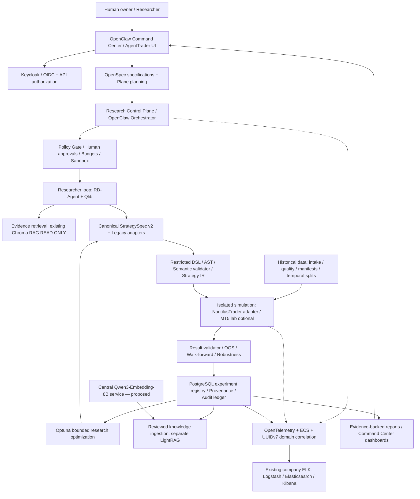

# AutomaticTrading AI

**AI-powered trading research, strategy engineering, optimization, and reproducible backtesting.**

AutomaticTrading is building a **research-first engineering ecosystem** for systematic trading strategies. Our priorities are **scientific evaluation, reproducibility, trustworthy evidence, security boundaries, and observability**—not promises of profit.

> **Project status:** This page presents a **target architecture and roadmap**, not a deployment inventory. Components may be existing, partially implemented, being evaluated, or planned. A passing CI run, a merged PR, an architecture document, and a verified deployment are different milestones. **No real-money or live trading is authorized in the research platform.**

## Vision

Build an end-to-end, controlled research workflow that turns ideas and evidence into versioned, testable strategy specifications, isolated simulations, rigorously evaluated experiments, and searchable, auditable research knowledge—all coordinated through the existing OpenClaw / AgentTrader command center.

## Planned architecture

The architecture below represents the **complete intended ecosystem**. It is a design blueprint; individual integration points will be implemented only after read-only audits, compatibility checks, isolated tests, and separately approved changes.

### 1. Human oversight, applications, and project planning

| Component | Intended responsibility | Boundary / status |
| --- | --- | --- |
| **OpenClaw Command Center** | Central web dashboard for research jobs, approvals, pipeline state, blockers, evidence, and reporting | Existing application; source and production deployment must be verified separately |
| **AgentTrader / AutoTrade** | Strategy research lifecycle, intake, specification handoffs, simulated runs, and experiment progress | Some modules exist in the panel source; complete integration is not yet verified |
| **OpenClaw orchestration** | Coordinate specialized research agents and bounded tool invocations | Existing integrations and exact permissions require read-only verification |
| **Keycloak / OIDC** | Authenticated sessions and role-aware access to application functions | Preserve existing configuration and security boundaries |
| **OpenSpec** | Version-controlled specifications, architecture decisions, acceptance criteria, and engineering tasks | Planned planning-as-code integration |
| **Plane** | Task tracking, ownership, milestones, blockers, and review workflow | Planned synchronization, not an authority to execute protected actions |
| **GitHub / CI** | Source control, code review, tests, provenance, pinned revisions, and release evidence | Build success does not imply production deployment |
| **Approval and policy engine** | Human approvals, scoped permissions, isolation, resource limits, deadline and stop policies | Extend verified controls; deny by default |

### 2. AI research and knowledge

| Component | Intended responsibility | Boundary / status |
| --- | --- | --- |
| **RD-Agent** | Research hypotheses, model/feature discovery, structured agent feedback, and research iterations | Evaluated/forked; platform integration planned |
| **Microsoft Qlib** | Quant research methods, features, datasets, and research experiments | Evaluated/forked; standardized adapters planned |
| **Existing ChromaDB RAG** | Retrieval of historical research context and cited evidence | **Existing data stays intact; retrieval is read-only** |
| **LightRAG (separate)** | New, curated research knowledge representation and retrieval | Planned independently; do not overwrite or migrate the existing RAG |
| **Qwen3-Embedding-8B central service** | Shared, version-pinned embeddings for authorized new knowledge pipelines | Proposed; hardware, serving mode and compatibility must be benchmarked |
| **Knowledge validation and ingestion gate** | Admit only provenance-backed, reviewed knowledge to new indexes | Explicit authorization and append-only patterns where approved |
| **Research feedback loop** | Learn from rejected hypotheses, invalid tests, limitations, and validated experiments | Planned; guard against confirmation bias and polluted memory |

### 3. Strategy engineering and compilation

| Component | Intended responsibility | Boundary / status |
| --- | --- | --- |
| **StrategySpecification v1** | Existing research-linked strategy hypothesis, market/timeframe, entry/exit rules, assumptions, and citations | Preserve current contract and consumers |
| **Intake / workflow StrategySpec** | Interactive strategy intake and execution-workflow representation | Reconcile with v1; avoid duplicate incompatible standards |
| **Canonical StrategySpec v2** | One engine-independent, explicitly versioned specification contract | **Proposed**; legacy adapters required |
| **Legacy adapters** | Lossless compatible mapping from existing specifications and intake models | Reject missing or ambiguous semantics rather than inventing them |
| **Restricted DSL / AST** | Structured rules without arbitrary code evaluation | Planned, with a strictly allowlisted operation set |
| **Semantic validator** | Type, timing, lookback, signal ordering, warmup, and execution-assumption checks | Planned; text-field completeness is not semantic correctness |
| **Strategy IR and canonical hashing** | Stable, reproducible, engine-neutral intermediate representation | Planned with deterministic serialization and versioned hashes |
| **Backend adapters** | Translate verified IR into supported simulator representations | Implement only after engine capability checks |
| **MQL5 generator / compiler worker** | Produce and potentially compile isolated test artifacts | Existing/proposed code may generate skeletons; compilation alone does not verify trading rules |

### 4. Market data and simulation infrastructure

| Component | Intended responsibility | Boundary / status |
| --- | --- | --- |
| **Market Data Intake** | Bring licensed historical research data into a separate dataset store | Proposed; no unapproved external downloads or existing-data moves |
| **Market Data Normalizer** | Normalize timestamps, instruments, timezone, price precision, bid/ask and bar/tick format | Planned |
| **Dataset quality engine** | Flag gaps, duplicates, stale records, invalid quotes, and temporal leakage | Planned |
| **Immutable dataset manifest** | Source, revision/hash, time range, instrument, assumptions, and provenance | Planned; use content-addressed artifacts |
| **Temporal split manager** | Train/validation/out-of-sample/holdout partitions with no future-data leakage | Planned |
| **NautilusTrader** | Event-driven, isolated historical strategy simulation | Fork exists; choose and pin an exact compatible v2 revision before adapter development |
| **NautilusTrader adapter** | Instrument mapping, data conversion, simulated execution, results, and golden-trace comparison | Planned; no proven end-to-end adapter yet |
| **MT5 Strategy Lab** | Optional experimental MQL5 compilation and headless backtesting on Linux where feasible | Distinct bounded research path; no real broker trading |
| **Synthetic fixtures / golden tests** | Deterministic validation of engine behavior and expected signal/event traces | Do not label synthetic results as evidence of market profitability |
| **Simulation cost and fill models** | Explicit spread, commission, slippage, latency and matching assumptions | Version and validate assumptions per experiment |

### 5. Optimization, experiment registry, and research validation

| Component | Intended responsibility | Boundary / status |
| --- | --- | --- |
| **Optuna** | Budgeted research-only hyperparameter and hypothesis search | Planned/forked; isolate final holdouts from optimization |
| **Experiment registry** | Stable records of hypotheses, versions, datasets, runs, outcomes, and reasons | Existing initial in-memory and PostgreSQL adapters; DB integration needs verification |
| **PostgreSQL** | Authoritative relational experiment metadata, workflow state, audit ledger and outbox | Proposed/partially implemented contracts; live migration or deployment unverified |
| **Artifact store** | Immutable strategy IR, generated files, manifests, simulation results, reports and hashes | Planned on an approved, verified storage location |
| **Evaluation engine** | Out-of-sample, walk-forward, leakage, sensitivity, robustness, baselines and uncertainty checks | Extend initial evaluation rather than treating simple profit thresholds as proof |
| **Experiment lineage** | Reconstruct who proposed, approved, ran and evaluated each experiment | Planned cross-component identifiers and provenance links |
| **Idempotency / outbox / recovery** | Avoid duplicate work after retries and preserve durable events across failures | Planned extensions with real concurrency tests |
| **Research reports** | Evidence-backed narratives with explicit limitations and reproducibility links | Report verified findings, rejected hypotheses, and unknowns |

### 6. Observability, auditability, and operations

| Component | Intended responsibility | Boundary / status |
| --- | --- | --- |
| **Existing company ELK stack** | Reuse Logstash, Elasticsearch, and Kibana for telemetry, search and dashboards | Existing repository; actual company runtime/configuration still requires verification |
| **OpenTelemetry** | Cross-service logs, traces and metrics across Node/.NET/Python workers | Planned instrumentation and appropriate ingestion bridge |
| **ECS event schemas** | Consistent timestamp, service, outcome, action and correlation fields | Planned shared telemetry contracts |
| **UUIDv7 domain IDs** | Correlate workflow, strategy, experiment, agent run and audit event identities | Planned for new records; preserve mappings for legacy IDs |
| **W3C Trace Context** | Distributed trace and span propagation, distinct from UUIDv7 IDs | Planned; do not substitute a domain UUID for an OTel trace ID |
| **Kibana workflows** | Browse end-to-end research timelines, errors, resource use, and experiment evidence | Design only; live dashboards not verified |
| **Security/audit trail** | Immutable approvals, denied actions, policy decisions, and provenance | PostgreSQL ledger authoritative; ELK is not the sole source of truth |
| **Supervisor / harness** | Queue, worker lease, reconciliation, bounded tools, failure handling and review gates | Proposed/partially implemented; must not circumvent host or approval controls |
| **CI/CD and release gates** | Exact SHA, passing tests, preflight evidence and separately authorized releases | Merge, release and deployment must remain distinct |

### 7. End-to-end research lifecycle

1. **Research intake:** A human submits a research question or strategy idea through the Command Center.
2. **Evidence retrieval:** Read-only retrieval gathers cited existing knowledge; RD-Agent and Qlib may propose hypotheses.
3. **Specification:** Existing inputs are normalized into a Canonical StrategySpec without guessing missing rules.
4. **Semantic gate:** Restricted DSL, AST checks, timing semantics and engine capability checks reject invalid or unsupported ideas.
5. **Dataset gate:** Historical datasets are validated, hashed, versioned and split chronologically.
6. **Isolated simulation:** NautilusTrader (or a separately approved MT5 research adapter) runs without real-account access.
7. **Evidence validation:** Golden traces, reproducibility, costs, out-of-sample and walk-forward checks generate evidence and limitations.
8. **Registration:** PostgreSQL persists experiments, approvals and outcomes, linked to immutable artifacts.
9. **Observability:** OpenTelemetry/ECS events correlate workflow and simulation steps within the existing company ELK.
10. **Controlled improvement:** Optuna and research agents may propose bounded follow-up experiments; humans review policy-sensitive decisions.
11. **Knowledge reuse:** Only reviewed findings may be ingested into a separate new knowledge index under explicit authorization.
12. **Human review:** The dashboard presents what is verified, inferred, unavailable, blocked or proposed—not an unqualified success claim.

### 8. Versioning and evidence contract

- **Domain IDs:** New workflow, strategy, strategy-version, experiment, agent-run and event identifiers should use **UUIDv7**. Existing identifiers are preserved.
- **Trace IDs:** OpenTelemetry/W3C 128-bit trace IDs and 64-bit span IDs use their standard formats independently of UUIDv7.
- **Reproducibility inputs:** Record specification/IR hash, dataset snapshot hash, instrument metadata, source SHA, engine revision, runtime image or environment, seed, cost and fill models, and evaluation policy.
- **Evidence labels:** Distinguish source generation, compilation, simulated execution, result validation, synthetic fixtures and unavailable data. No automatic promotion between levels.
- **Reliability:** Apply idempotency keys, bounded retries, outbox delivery, deduplication and restart-safe reconciliation where implemented and tested.

### 9. Safety, boundaries, and change policy

- **Research only:** No authorized live-order execution or real-account access.
- **Read-only audit first:** Inspect source, CI, dependencies, mounts, service state and runtime identity before making changes.
- **Preserve existing RAG:** No deletion, overwriting, destructive migration or unapproved ingestion involving existing ChromaDB records, vectors, collections, metadata, volumes or backups.
- **Keep operational services stable:** No automated production deploys, service restarts, Gateway/Keycloak/Nginx/Cron/MT5 changes, or permission expansion without a separate owner approval.
- **No agent-managed infrastructure snapshots:** Snapshot management remains with the owner.
- **Protect sensitive information:** No credentials, full private prompts, raw RAG content, embeddings, or private datasets in repositories or telemetry.
- **Limit agent authority:** Explicit allowlists, scoped approvals, isolated worker environments, resource/time budgets and fail-closed access checks.
- **Stay compatible:** Reuse existing modules and public contracts; extend with versioned adapters instead of replacing production systems.
- **Storage planning:** New datasets and experiment artifacts belong on a separately approved, verified mount rather than being assumed safe on the OS disk.
- **Deployment separation:** The OpenClaw Command Center project port is **3103**; the running server and deployed SHA still require independent confirmation.

### 10. Implementation phases and validation gates

| Phase | Deliverable | Required evidence |
| --- | --- | --- |
| **0 — Read-only audit** | Baseline SHAs, PR reconciliation, source/runtime gap matrix, permissions and mount inventory | Verifiable read-only findings; no changes |
| **1 — Contract reconciliation** | Canonical StrategySpec v2 and backward-compatible adapters | Existing tests + negative ambiguity cases |
| **2 — Semantic compiler** | DSL, AST, typed Strategy IR and capability checks | Deterministic golden tests; no arbitrary-code execution |
| **3 — Data & simulator** | Historical-data contract and pinned Nautilus research adapter | Synthetic event traces, reproducible outputs, no live capability |
| **4 — Registry & evaluation** | PostgreSQL integration and scientifically constrained result validation | Disposable DB integration tests, idempotency, rollback, OOS evidence |
| **5 — Telemetry & knowledge** | UUIDv7/OTel integration with existing ELK and approved new knowledge pipeline | Correlated events, redaction, no existing-RAG changes |
| **6 — Research orchestration** | Bounded RD-Agent, Qlib, Optuna and Command Center integrations | Policy/approval enforcement, restart-safe handling and human review |
| **7 — Controlled release** | Reviewed commit, passing CI, fresh preflight and deployment proposal | **Separate owner approval for the exact release SHA** |

None of the phases above is a claim that a service is currently deployed or ready for production.

## Technology roadmap

The technology portfolio is deliberately modular. A fork or repository alone does not establish that its service is running or that its APIs are integrated.

| Domain | Technologies / systems |
| --- | --- |
| User experience | Next.js / React Command Center, AgentTrader views |
| Identity and authorization | Existing Keycloak/OIDC, scoped role checks, independent policy and approval records |
| Agent orchestration | OpenClaw, research agents, supervisor, bounded execution workers |
| Planning and collaboration | OpenSpec, Plane, GitHub issues/PRs and CI |
| Research | RD-Agent, Microsoft Qlib, controlled model/feature experimentation |
| Strategy engineering | StrategySpecification, Canonical StrategySpec, restricted DSL, Strategy IR, code adapters |
| Backtesting | NautilusTrader, optional Linux-based isolated MT5 Strategy Lab |
| Parameter optimization | Optuna with search budgets and untouched final holdouts |
| Data | Historical market datasets, quality checks, immutable manifests, versioned storage |
| Structured state | PostgreSQL experiment registry, policy history, audit ledger and outbox |
| Research knowledge | Existing read-only ChromaDB, separate LightRAG, proposed Qwen3-Embedding-8B service |
| Observability | Existing ELK, OpenTelemetry, Elastic Common Schema, UUIDv7 correlation |
| Engineering quality | Unit/contract/integration tests, golden traces, security regression and reproducible artifacts |

## Engineering principles

1. **Re-use before rebuilding:** Existing code and operational services are starting points, not disposable prototypes.
2. **Evidence before claims:** Distinguish implemented code, merged changes, validated tests, actual deployments and scientifically supported findings.
3. **Reproducibility by default:** Versions, datasets, assumptions, costs and outputs must be traceable.
4. **Strict knowledge preservation:** Existing RAG data remains untouched unless a narrowly scoped separate authorization changes that rule.
5. **Research-only execution:** Never promote experimental agents or simulations into live brokerage operations.
6. **Independent authorization:** Planner messages, model output and UI flags are not sufficient execution authority.
7. **Incremental delivery:** Small reviewed PRs with compatibility tests precede deployment proposals.

## Architecture documentation

Versioned design documents are maintained in the **[AutomaticTrading/Document](https://github.com/AutomaticTrading/Document)** repository:

- [AgentTrader Research Lab — Architecture v1.0](https://github.com/AutomaticTrading/Document/blob/main/docs/AgentTrader_Research_Lab_Architecture_v1.0.md)
- [OpenSpec + Plane Planning & Execution Harness](https://github.com/AutomaticTrading/Document/blob/main/docs/AutomaticTrading_OpenSpec_Plane_Planning_Execution_Harness_v1.0.md)
- [Qwen3-Embedding-8B Central Service](https://github.com/AutomaticTrading/Document/blob/main/docs/Qwen3_Embedding_8B_Central_Service_v1.0.md)
- [Existing ELK Observability & UUIDv7](https://github.com/AutomaticTrading/Document/blob/main/docs/AutomaticTrading_ELK_Observability_UUIDv7_Architecture_v1.0.md)
- [Implementation Gap Closure: StrategySpec, NautilusTrader and Delivery Plan](https://github.com/AutomaticTrading/Document/blob/main/docs/AutomaticTrading_Implementation_Gap_Closure_StrategySpec_Nautilus_v2.md)

Some documents may be access-restricted. Architectural designs are not proof of deployed infrastructure.

## Project status

**Architecture and integration planning with existing partial application code.** The current GitHub application baseline, PR status, CI results, server state, data storage and downstream services must be checked independently before implementation or release. The planned architecture is not a statement that all components are installed or operational.

## Links

- [AutomaticTrading GitHub organization](https://github.com/AutomaticTrading)
- [OpenClaw Command Center repository](https://github.com/MassoudKargar/OpenClaw_Panel)
- [Existing ELK repository](https://github.com/AutomaticTrading/docker-elk-tls)

---

*Research software only. Nothing here constitutes investment advice, a promise of returns, or a claim of realized trading performance.*